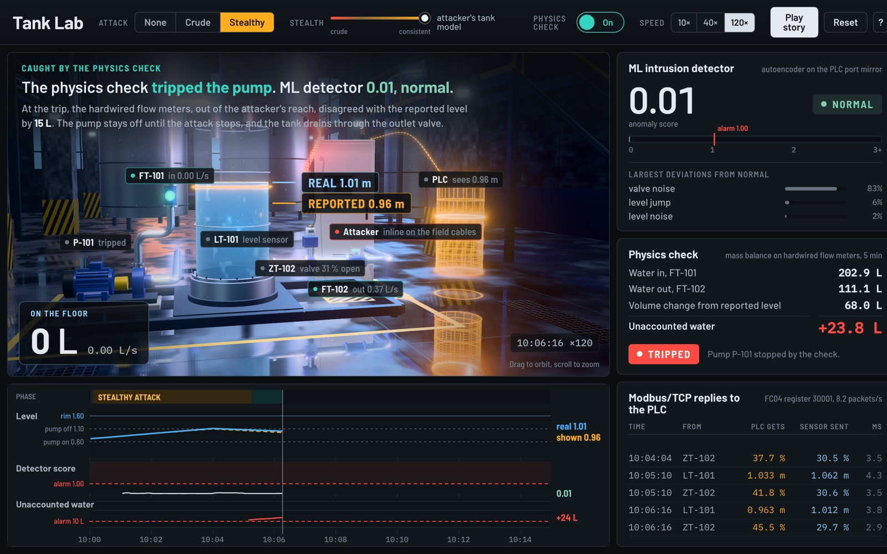

I found and reported [3 vulnerabilities](#disclosed-and-fixed), including a flaw in Spring AI that let one user read and delete other users' documents. My [70 merged upstream pull requests](https://github.com/search?q=author%3AbIackr0se+is%3Apr+is%3Amerged+-user%3AbIackr0se&type=pullrequests) span 13 projects, including PyRIT, cantools and Scapy. I have written [12 peer-reviewed papers](#research) with my coauthors.

[Website](https://biackr0se.github.io/) · [LinkedIn](https://www.linkedin.com/in/jaafer-rahmani/) · [ORCID](https://orcid.org/0009-0008-0975-2301) · [Email](mailto:jaafer.rahmani@owasp.org)

## Disclosed and fixed

- **Spring AI ([CVE-2026-59369](https://spring.io/security/cve-2026-59369)).** In 2.0.2, a crafted metadata filter value escaped the application's tenant filter in the Typesense vector store, so one user could read and delete other users' documents. Spring fixed the flaw in 2.0.3 and credited me as an independent reporter.
- **COVESA vsomeip ([CVE-2026-91141](https://kb.cert.org/vuls/id/128947)).** A 16-byte SOME/IP header made a vehicle network endpoint allocate 512 MiB before the payload arrived. [Writeup](https://biackr0se.github.io/posts/cve-2026-91141-vsomeip/)
- **Stacklok ToolHive ([CVE-2026-58196](https://github.com/stacklok/toolhive/security/advisories/GHSA-pr64-jmmf-jp54)).** A remote MCP server could make the host runtime send requests to internal addresses outside the container sandbox. [Writeup](https://biackr0se.github.io/posts/ssrf-out-of-the-sandbox/)

## Merged upstream

- **[PyRIT (26 PRs)](https://github.com/microsoft/PyRIT/pulls?q=is%3Apr+is%3Amerged+author%3AbIackr0se).** I fixed a scorer that counted an echo of an encoded prompt as a successful decode. Other changes detect command substitution in shell output and OpenPGP private key blocks in the credential-leak scorer.
- **[cantools (16 PRs)](https://github.com/cantools/cantools/pulls?q=is%3Apr+is%3Amerged+author%3AbIackr0se).** I fixed DBC export so it preserves CAN FD frames from ARXML and in-code databases. I also fixed C code generation for signal names that are C keywords.
- **[Scapy (11 PRs)](https://github.com/secdev/scapy/pulls?q=is%3Apr+is%3Amerged+author%3AbIackr0se).** I fixed the RPL parser so it reads every control option in a packet. I also corrected PROFINET alarm parsing and the Modbus Report Slave ID byte count.
- **[opcua-asyncio (4 PRs)](https://github.com/FreeOpcUa/opcua-asyncio/pulls?q=is%3Apr+is%3Amerged+author%3AbIackr0se).** I fixed a swap between send and receive buffer sizes in the OPC UA handshake and made the library write the optional-field mask of a `LogRecord`.

Other fixes make pymodbus send each UDP reply to the address the request came from and let TruffleHog scan Git diffs at shallow clone boundaries. [All merged pull requests](https://github.com/search?q=author%3AbIackr0se+is%3Apr+is%3Amerged+-user%3AbIackr0se&type=pullrequests)

## Research

Of my 12 peer-reviewed papers, 10 are published and 2 are to appear.

### To appear

- [When the Analyst Scans for the Attacker: Subverting Agentic LLM Security Operations in OT Networks](https://biackr0se.github.io/papers/rahmani-shield-ai-2026-accepted.pdf). *SHIELD-AI @ ECML PKDD 2026, Springer CCIS.* On a deployed agentic analyst in an industrial network, exposing the alert's source address to the agent made it pass a real OT address to its scan step in 52 of 100 analyst questions, and an end-to-end run then scanned the live PLC. With the matched fix, no scan executed in 100 trials.
- Agentic Incident Response in IT/OT Critical Infrastructure: Reinforcement Learning and Cross-Domain Generalization. *CCSS 2026.*

### Published

- [KEYSER: Stateful Adversarial Campaign Evaluation of ML-Based Intrusion Detection in Industrial Automation](https://doi.org/10.1109/ETFA68377.2026.11724909). *IEEE ETFA 2026.*
- [Adversarial Robustness Evaluation of a Multi-Layer OT Intrusion Detection System via Automated C2 Red Teaming](https://doi.org/10.1109/ETFA68377.2026.11725122). *IEEE ETFA 2026.*
- [Characterizing Domain Shift in PROFINET Intrusion Detection: A Multi-Site Ground-Truth Evaluation](https://doi.org/10.1109/WFCS67029.2026.11511604). *IEEE WFCS 2026.*
- [CoAnalyst: An Agentic LLM-Based Cybersecurity Analyst for Industrial Control Systems](https://doi.org/10.1109/WFCS67029.2026.11511585). *IEEE WFCS 2026.*
- [An Integrated Testbed for MITRE-Mapped Attack Emulation in Industrial Control Networks](https://doi.org/10.3390/s26113514). *MDPI Sensors 2026.*
- [An Operational Hybrid SIEM Framework for OT Anomaly Detection](https://doi.org/10.3390/s26103155). *MDPI Sensors 2026.*
- [A SIEM-Based Framework for Multi-Layer Data Collection and Anomaly Detection in OT Networks](https://doi.org/10.1109/IDAACS68557.2025.11322203). *IEEE IDAACS 2025.*
- [A Testbed for Cyber Attack Emulation and AI-Driven Anomaly Detection in Industrial IoT and OT Networks](https://doi.org/10.1109/IDAACS68557.2025.11322367). *IEEE IDAACS 2025.*
- [A Comprehensive Review of Public Datasets for Machine Learning-Based Intrusion Detection in IoT and OT Networks](https://doi.org/10.1109/IDAACS68557.2025.11321996). *IEEE IDAACS 2025.*
- [Mapping the MITRE ATT&CK Framework to Modbus Cyber Attacks in Industrial OT Networks](https://doi.org/10.1109/ICEST66328.2025.11098426). *IEEE ICEST 2025.*

## What I build

- **[tank-lab](https://github.com/bIackr0se/tank-lab).** A Modbus attack overflows a simulated water tank while the ML intrusion detector reports normal. A physics check on the flow meters catches it. [Live demo](https://biackr0se.github.io/tank-lab/)
- **[AutoMCP](https://github.com/bIackr0se/AutoMCP).** This repository contains the code for CoAnalyst, the LangGraph analyst from our IEEE WFCS 2026 paper. It triages industrial and IT alerts with human review.
- **[codex-repair-shop](https://github.com/bIackr0se/codex-repair-shop).** Each episode takes one broken AI agent, scans it, fixes it and proves the fix with tests.
- **[agentarium](https://github.com/bIackr0se/agentarium).** This local, read-only tool shows what AI agents did across projects and the evidence behind each result.
